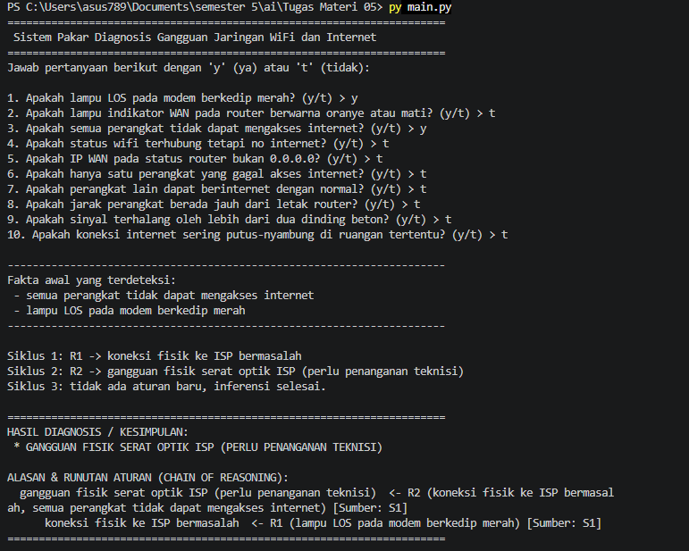
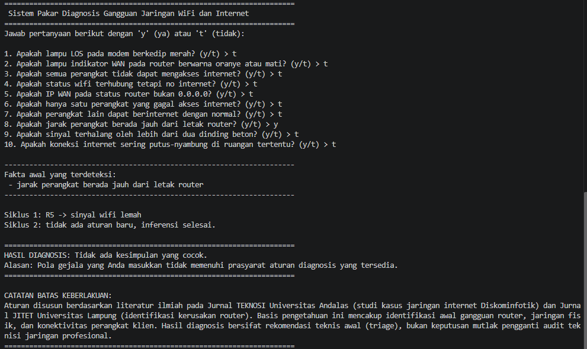
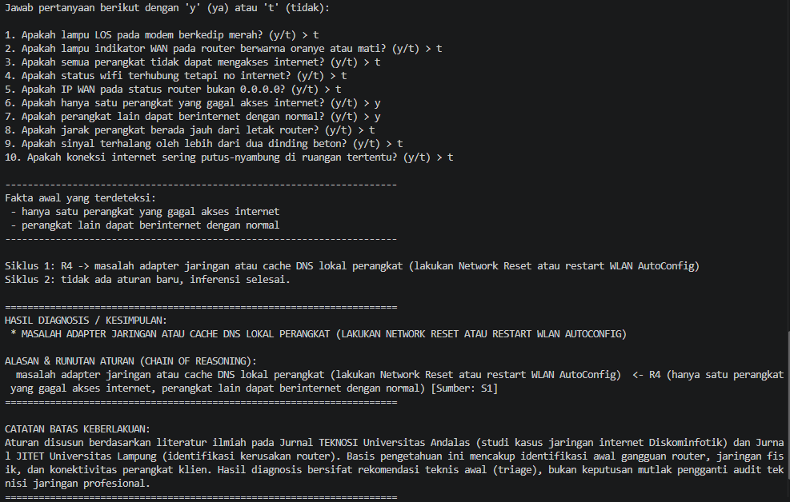

# Tugas 5 — Sistem Pakar Diagnosis Jaringan WiFi dan Internet

- **Nama**: I Made Priyandika Adiyatma Putra Sari
- **NIM**: F1D02410008

---

## 1. Topik dan Cara Menjalankan Program

### Topik
Sistem Pakar untuk mendiagnosis penyebab umum gangguan jaringan WiFi dan koneksi internet (router, koneksi fisik ISP, dan adapter klien) serta memberikan rekomendasi solusi teknis berbasis aturan pakar (*rule-based*).

### Kebutuhan Sistem
- Python 3.8 atau lebih baru.
- Tidak memerlukan pustaka tambahan eksternal (hanya modul standar bawaan Python: `json`, `os`, `sys`).

### Perintah Menjalankan
Buka terminal atau PowerShell pada direktori proyek, lalu jalankan perintah berikut:
```bash
python main.py
```

---

## 2. Daftar Sumber dan Tabel Aturan

### Daftar Sumber
1. **S1**: Ahmad Zaki, Sarjon Defit, Sumijan, dan Rahmi Fauzana (2023), *"Sistem Pakar Menggunakan Metode Forward Chaining Untuk Mendeteksi Kerusakan Jaringan Internet (Studi Kasus: Di Layanan Internet Diskominfotik Sumatera Barat)"*, **Jurnal Nasional Teknologi dan Sistem Informasi (TEKNOSI)**, Vol. 9, No. 3, hal. 227–236, Penerbit: Fakultas Teknologi Informasi Universitas Andalas. DOI: [https://doi.org/10.25077/TEKNOSI.v9i3.2023.227-236](https://doi.org/10.25077/TEKNOSI.v9i3.2023.227-236)
2. **S2**: Gizwa Budi Nugraha dan Rosyid Eko Nugroho (2025), *"Implementasi Sistem Pakar dengan Forward Chaining untuk Identifikasi Kerusakan Router"*, **Jurnal Informatika dan Teknik Elektro Terapan (JITET)**, Vol. 13, No. 3, Penerbit: Jurusan Teknik Elektro Universitas Lampung. DOI: [https://doi.org/10.23960/jitet.v13i3.6593](https://doi.org/10.23960/jitet.v13i3.6593)

### Tabel Aturan (Knowledge Base)

| Aturan | IF (Syarat) | Mode | THEN (Hasil) | Sumber |
|---|---|---|---|---|
| **R1** | lampu LOS pada modem berkedip merah **OR** lampu indikator WAN pada router berwarna oranye atau mati | ATAU | koneksi fisik ke ISP bermasalah | S1 |
| **R2** | koneksi fisik ke ISP bermasalah **AND** semua perangkat tidak dapat mengakses internet | DAN | gangguan fisik serat optik ISP (perlu penanganan teknisi) | S1 |
| **R3** | status wifi terhubung tetapi no internet **AND** IP WAN pada status router bukan 0.0.0.0 | DAN | kegagalan server DNS (konfigurasikan DNS publik 8.8.8.8 atau 1.1.1.1 pada router) | S2 |
| **R4** | hanya satu perangkat yang gagal akses internet **AND** perangkat lain dapat berinternet dengan normal | DAN | masalah adapter jaringan atau cache DNS lokal perangkat (lakukan Network Reset atau restart WLAN AutoConfig) | S1 |
| **R5** | jarak perangkat berada jauh dari letak router **OR** sinyal terhalang oleh lebih dari dua dinding beton | ATAU | sinyal wifi lemah | S2 |
| **R6** | sinyal wifi lemah **AND** koneksi internet sering putus-nyambung di ruangan tertentu | DAN | interferensi dan redaman sinyal tinggi (pindahkan letak router atau pasang Wi-Fi Range Extender/Mesh) | S2 |

> *Catatan Aturan Berantai (Chaining):*
> - **R1** menghasilkan fakta antara *"koneksi fisik ke ISP bermasalah"*, yang kemudian digunakan sebagai premis oleh **R2**.
> - **R5** menghasilkan fakta antara *"sinyal wifi lemah"*, yang kemudian digunakan sebagai premis oleh **R6**.

---

## 3. Metode yang Dipilih dan Alasannya

Metode yang dipilih adalah **Forward Chaining (Penalaran Maju)**.

**Alasan Pemilihan:**
1. Pendekatan diagnosis gangguan teknis sangat selaras dengan prinsip *data-driven*, di mana inferensi dimulai dari gejala-gejala konkret yang diamati pengguna di lapangan (fakta awal).
2. Dari fakta awal tersebut, sistem bekerja maju menelusuri rantai aturan untuk menurunkan fakta-fakta perantara hingga mencapai kesimpulan akhir.
3. Mesin Forward Chaining memungkinkan pelacakan alasan (*chain of reasoning*) secara bertingkat sehingga pengguna dapat mengetahui asal-usul rekomendasi yang diberikan.

---

## 4. Tiga Kasus Uji dan Screenshot

### Kasus 1: Gangguan Fisik Kabel ISP (Aturan Bertingkat R1 -> R2)
- **Kondisi Uji:** Pengguna mengalami lampu LOS modem berkedip merah dan seluruh perangkat terputus dari internet.
- **Jawaban Pertanyaan:**
  - `lampu LOS pada modem berkedip merah` = **y**
  - `semua perangkat tidak dapat mengakses internet` = **y**
  - (Pertanyaan lainnya dijawab **t**)
- **Hasil yang Diharapkan:** 
  - Siklus 1 memicu **R1** -> `koneksi fisik ke ISP bermasalah`
  - Siklus 2 memicu **R2** -> `gangguan fisik serat optik ISP (perlu penanganan teknisi)`
- **Screenshot:**
  

---

### Kasus 2: Kasus Negatif (Tidak Ada Kesimpulan)
- **Kondisi Uji:** Pengguna hanya menjawab "ya" pada satu premis parsial yang tidak mencukupi untuk menarik kesimpulan akhir.
- **Jawaban Pertanyaan:**
  - Hanya menjawab **y** pada: `jarak perangkat berada jauh dari letak router`.
  - (Pertanyaan lainnya dijawab **t**)
- **Hasil yang Diharapkan:** 
  - Siklus 1 memicu fakta antara R5 (`sinyal wifi lemah`), namun syarat untuk R6 tidak lengkap.
  - Program menampilkan: *"HASIL DIAGNOSIS: Tidak ada kesimpulan yang cocok."*
- **Screenshot:**
  

---

### Kasus 3: Masalah Adapter Lokal Klien (Aturan R4)
- **Kondisi Uji:** Hanya satu laptop yang bermasalah, sementara perangkat lainnya dapat berinternet dengan normal.
- **Jawaban Pertanyaan:**
  - `hanya satu perangkat yang gagal akses internet` = **y**
  - `perangkat lain dapat berinternet dengan normal` = **y**
  - (Pertanyaan lainnya dijawab **t**)
- **Hasil yang Diharapkan:** 
  - Siklus 1 memicu **R4** -> `masalah adapter jaringan atau cache DNS lokal perangkat (lakukan Network Reset atau restart WLAN AutoConfig)`
- **Screenshot:**
  

---

## 5. Batas Keberlakuan

Aturan dalam sistem pakar ini disusun berdasarkan literatur ilmiah pada Jurnal TEKNOSI Universitas Andalas (studi kasus jaringan internet Diskominfotik) dan Jurnal JITET Universitas Lampung (identifikasi kerusakan router). Basis pengetahuan ini mencakup identifikasi awal gangguan router, jaringan fisik, dan konektivitas perangkat klien. Hasil diagnosis dan rekomendasi penanganan yang ditampilkan oleh program bersifat saran teknis awal (*triage*), bukan keputusan mutlak pengganti audit teknisi jaringan profesional. Apabila gangguan bersumber dari pemeliharaan server ISP di tingkat pusat (*backbone*) atau putusnya kabel fisik di tiang distribusi, penanganan tetap membutuhkan intervensi teknisi resmi dari penyedia layanan internet.

---

## 6. Penggunaan Alat Bantu AI

Dalam pengerjaan tugas ini, alat bantu AI (Gemini) digunakan untuk:
1. Membantu merancang struktur logika file `main.py`.
2. Membantu penyusunan file format JSON `kb_wifi.json`
3. Membantu mencari ide untuk topik yang akan digunakan.
